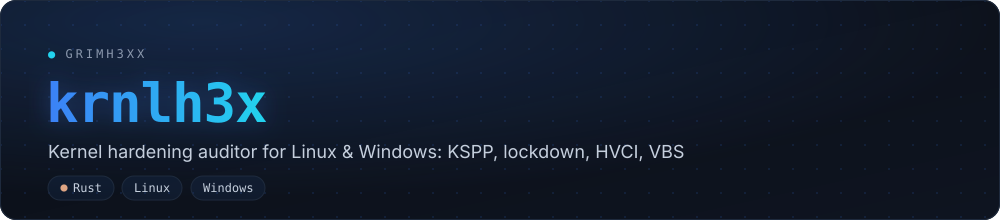
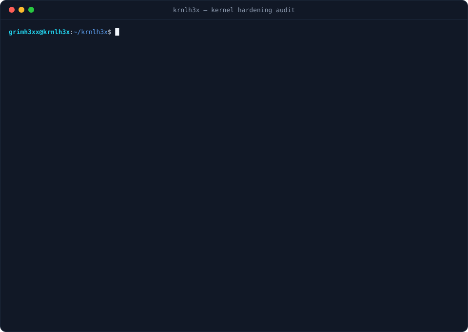

[](https://github.com/grimh3xx/krnlh3x/actions)
[](LICENSE)


**A read-only kernel hardening auditor for Linux and Windows, in Rust.**
krnlh3x reads the running kernel's real state, not just its configuration
files. It scores the result against KSPP and Microsoft baselines and prints
the exact command that fixes each gap.


<p align="center"></p>

<sub>Recorded from real output on a WSL2 kernel. Regenerate with `python3 tools/gen_demo.py`.</sub>

## Linux

| Area | What is checked |
|---|---|
| `sysctl` | 19 KSPP knobs: `kptr_restrict`, `unprivileged_bpf_disabled`, `perf_event_paranoid`, `ptrace_scope`, `kexec_load_disabled`, `protected_*`, `mmap_min_addr`, `io_uring_disabled`, `unprivileged_userfaultfd`, … |
| `lockdown` | Kernel lockdown mode (`none` / `integrity` / `confidentiality`) |
| `modules` | `sig_enforce`, `modules_disabled` |
| `taint` | Every taint bit decoded: forced loads, unsigned / out-of-tree modules, oopses, ACPI table overrides |
| `cpu` | Every entry in `/sys/devices/system/cpu/vulnerabilities/`. Unmitigated (high), partially mitigated (medium) and SMT-exposed (low) are graded separately |
| `cmdline` | Dangerous boot parameters (`mitigations=off`, `nokaslr`, `nopti`, `iommu=off`, `selinux=0`, …) plus recommended hardening ones |
| `lsm` | A MAC LSM is active, SELinux is enforcing, Landlock is present |
| `kconfig` | 37 KSPP build options from `/proc/config.gz` (gunzipped in-process) or `/boot/config-*`, with the 6.9+ `CONFIG_MITIGATION_*` renames handled |

## Windows

All runtime state is read from the kernel through `NtQuerySystemInformation`.
These are the same information classes msinfo32 and Microsoft's
SpeculationControl module use.

| ID | Check |
|---|---|
| WCI-001..007 | Driver signature enforcement, test signing, kernel debugger, **HVCI** (enforced / audit / strict), UMCI (WDAC) |
| WCI-008 | Microsoft vulnerable driver blocklist |
| WVBS-001 | VBS secure kernel running (`SystemIsolatedUserModeInformation`) |
| WVBS-002 | Credential Guard actually running (`LsaIso.exe` is present, not just a policy value) |
| WVBS-003 | Kernel-mode hardware-enforced stack protection (CET) |
| WLSA-001/002 | LSA protection (RunAsPPL); WDigest cleartext credential caching |
| WMEM-001 | System DEP policy |
| WSPC-001..007 | Spectre v2 / BTI, Meltdown (KVA shadow), L1TF, MDS, SSBD and SMEP, plus mitigations disabled through `FeatureSettingsOverride` |

## Install

**Pre-built binaries** (from [Releases](https://github.com/grimh3xx/krnlh3x/releases/latest)):

```sh
# Linux x64
curl -fsSL -o krnlh3x https://github.com/grimh3xx/krnlh3x/releases/latest/download/krnlh3x-linux-x64
chmod +x krnlh3x && sudo mv krnlh3x /usr/local/bin/
```

```powershell
# Windows x64 (PowerShell)
iwr https://github.com/grimh3xx/krnlh3x/releases/latest/download/krnlh3x-windows-x64.exe -OutFile krnlh3x.exe
.\krnlh3x.exe --help
```

**From source** (Rust 1.82+):

```sh
cargo install --git https://github.com/grimh3xx/krnlh3x
```

Windows checks work from a normal shell; some registry policy values read better elevated. The binaries are not code-signed, so SmartScreen or Defender may flag
them heuristically. Build from source if you prefer to verify.

## Usage

```sh
krnlh3x                       # audit; shows failing checks + findings + score
krnlh3x -a                    # list every check, passing ones too
krnlh3x --area sysctl,cpu     # restrict to areas
krnlh3x --json | jq .score    # {"score": 71, "grade": "C", ...}
krnlh3x --sarif > k.sarif     # GitHub code scanning
krnlh3x --min-score 80        # exit 5 when the hardening score is below 80
krnlh3x --root /mnt/snapshot  # audit a captured /proc + /sys tree offline
```

The hardening score is the severity-weighted share of applicable checks that
pass. Critical checks weigh 10, high 6, medium 3 and low 1. Checks that do not
apply to this kernel (`n/a`) do not count. The exit code is the worst finding
shown (0–4), or 5 when `--min-score` is not met.

Example (WSL2 kernel):

```
  ▌ checks
    sysctl          ████████░░░░░░░░   9/17  8 failing
      ✗ KSYS-001   kernel.kptr_restrict                          0
      ✗ KSYS-010   fs.protected_symlinks                         0
    lockdown        ░░░░░░░░░░░░░░░░   0/1   1 failing
    cpu             ███████████████░  18/19  1 failing
      ✗ KCPU-SPEC_RSTACK_OVERFLOW  CPU vulnerability: spec_rstack_overflow  Vulnerable: Safe RET, no microcode
    kconfig         ████████████░░░░  28/37  9 failing
```

## Build

```sh
cargo build --release
cargo build --release --target x86_64-pc-windows-gnu
```

MIT © grimh3xx
